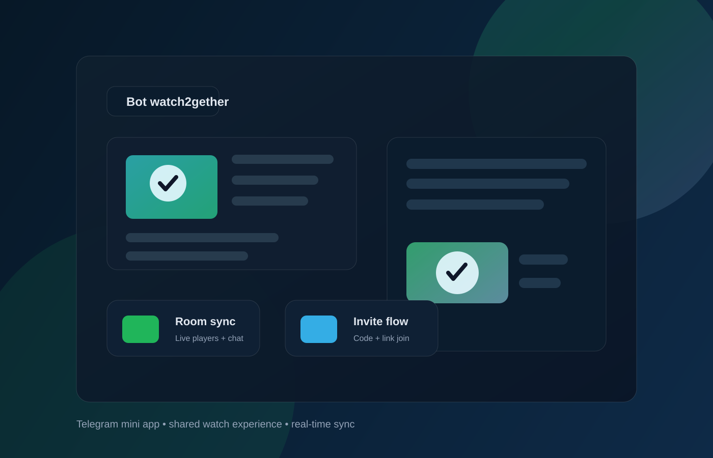

# Bot watch2gether

<p align="center">
  <a href="https://github.com/Smirty8181/Bot-watch2gether/releases/latest"></a>
  
  
  
  
  
</p>

<p align="center">
  
</p>

<h3 align="center">Совместный просмотр видео в Telegram Mini App</h3>

<p align="center">
  Комнаты, приглашения по коду, синхронный плеер, чат и потоковая координация в реальном времени.
</p>

<p align="center">
  <a href="https://t.me/sovmestniprosmotrbot">Бот в Telegram</a>
  ·
  <a href="https://github.com/Smirty8181/Bot-watch2gether">GitHub</a>
</p>

## Что умеет проект

- Создание комнаты и вход по коду из 6 символов
- Приглашения по ссылке или коду
- Синхронный просмотр YouTube, Rutube, VK, Twitch, Vimeo и прямых MP4
- Синхронизация play/pause/seek между участниками комнаты
- Чат внутри комнаты в реальном времени
- Автоматическое создание гостевого пользователя для локальной разработки
- Работа через Telegram Mini App

## Технологический стек

- Node.js 18+
- Express.js
- Socket.IO
- Grammy (Telegram Bot API)
- React + Vite
- Telegram Mini App / Web App

## Структура проекта

```text
.
├── server/                  # Backend, Telegram bot, комнаты, tunnel, media
│   ├── bot.js
│   ├── index.js
│   ├── rooms.js
│   ├── search.js
│   ├── telegramAgent.js
│   ├── tunnel.js
│   ├── upload.js
│   ├── video.js
│   └── ytsearch.js
├── web/                    # Frontend Mini App
│   ├── public/
│   ├── src/
│   ├── index.html
│   ├── package.json
│   └── vite.config.js
├── data/                   # Медиа и аватары
├── .env.example
├── .gitignore
├── LICENSE
├── README.md
├── package-lock.json
├── package.json
└── CHANGELOG.md
```

## Быстрый старт

### Требования

- Node.js 18+
- npm
- Telegram bot token

### 1. Установка зависимостей

```bash
npm install
```

### 2. Создание `.env`

Скопируйте шаблон:

```bash
cp .env.example .env
```

И заполните параметры:

```env
BOT_TOKEN=your_bot_token_here
PORT=3000
WEBAPP_URL=
TELEGRAM_API_IP=149.154.167.220
```

### 3. Запуск приложения

Локальная разработка без Telegram:

```bash
npm run dev
```

Откройте:

```text
http://127.0.0.1:5173
```

Гостевой пользователь создаётся автоматически.

Продакшн запуск:

```bash
npm start
```

## Как работает Telegram Mini App

Если `WEBAPP_URL` пустой, сервер сам пытается поднять HTTPS-туннель через Cloudflare. Это необходимо для корректной работы Telegram Mini App.

Если публичный адрес не статичен, можно задать свой домен/HTTPS через `WEBAPP_URL` (VPS, Railway, Render, Cloudflare Tunnel и др.).

## Настройка BotFather

После первого запуска:

1. Открой [@BotFather](https://t.me/BotFather)
2. Перейди в `/mybots`
3. Выбери бота и открой **Bot Settings**
4. Настрой Mini App и вставь тот же HTTPS URL
5. Добавь описание, короткое описание и аватар

Приглашения работают по схеме:

```text
https://t.me/sovmestniprosmotrbot?start=КОД
```

## Важные замечания

- Туннель `trycloudflare.com` может меняться после каждого перезапуска
- Для стабильного доступа лучше использовать `WEBAPP_URL` с постоянным HTTPS
- На некоторых сетях Telegram Bot API может требовать явный `TELEGRAM_API_IP`

## Разработка и CI

Проект настроен под современную разработку и может быть легко расширен:

- frontend на Vite
- backend на Node.js
- WebSocket синхронизация комнаты
- готовая структура для дальнейшего релиза и деплоя

## Лицензия

Проект распространяется под лицензией MIT.

## Контакты и поддержка

Если вы хотите доработать проект, добавить новые платформы или подготовить production-deploy — можно развивать проект дальше в этом репозитории.

---

<p align="center">
  Built with ❤️ for watching together.
</p>
